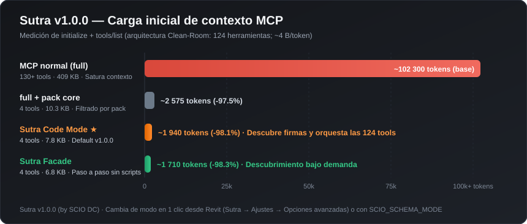

<p align="center">
  
</p>

<h1 align="center">Sutra — Revit MCP</h1>

<p align="center">
  <strong>Puente MCP modular, clean-room y local-first para Autodesk Revit 2023–2027</strong><br/>
  Desarrollado desde cero por <strong>Marco Poma · SCIO DC</strong> (Grupo POVA, Lima, Perú — <em>modelamos como quien ya construyó</em>)
</p>

<p align="center">
  <strong>Español</strong> · <a href="README.md"><strong>English</strong></a>
</p>

<p align="center">
  <a href="https://github.com/mpomav/sutra-revit-mcp/releases/latest"></a>
  
  
  
  <a href="PROVENANCE.md"></a>
  <a href="LICENSE"></a>
</p>

---

**Sutra** *(del nepalí/sánscrito **Sutradhara** — el maestro constructor que sostiene el hilo de replanteo)* es un **servidor MCP y add-in clean-room modular para Autodesk Revit 2023–2027** que conecta asistentes de IA (**Claude Desktop, Claude Code, Codex, Cursor, Windsurf, ChatGPT Work**) con una sesión viva de Revit en Windows.

Construido desde cero en **9 módulos de dominio** con **130 herramientas verificadas** (118 herramientas en módulos de Revit + 9 herramientas locales en el servidor — ver [PROVENANCE.md](PROVENANCE.md)).

### Por qué Sutra está diseñado distinto

1. **Seguridad transaccional (`ensayo → commit → relectura`):** toda escritura tipada arranca en `dry_run: true`, se ejecuta dentro de una transacción de Revit y verifica el resultado post-commit directamente sobre el modelo.
2. **C# in-process + SQLite local para el cuello de botella real de Revit:** los censos y metrados pesados corren en proceso dentro de Revit, escriben CSVs locales y se indexan en SQLite (`scio_query_local`, `scio_progress_takeoff`, `scio_report`, `scio_batch_audit`) sin saturar el chat.
3. **Contexto limpio sin degradación de herramientas (`Code Mode` por defecto):** exponer más de 100 esquemas a la vez satura el contexto inicial y degrada la precisión del LLM al elegir herramienta. **Sutra v1.0.0** arranca en **Code Mode** (`SCIO_SCHEMA_MODE=codemode`), exponiendo 4 meta-herramientas con `scio_list_tools` / `scio_describe_tool` bajo demanda y un sandbox JS local endurecido (`read_only: true` por defecto, límites estrictos de memoria/pasos/tiempo y bloqueo total de Python crudo).

---

## Carga inicial de contexto y modos de IA



Cambia entre **`codemode`** *(por defecto)*, **`facade`** y **`full`** mediante `SCIO_SCHEMA_MODE` o `%USERPROFILE%\.scio\settings.json` (`"schema_mode"`). Guía completa: [docs/TOKEN-MODES.md](docs/TOKEN-MODES.md).

---

## Arquitectura Clean-Room Modular (130 herramientas)

| Capa / Módulo | Rol |
| --- | --- |
| **`Scio.Abstractions`** | Contratos `[ScioTool]` por atributos, generación de JSON Schema por reflexión y sobres de verificación estandarizados. |
| **`Scio.Ipc`** | Transporte por Named Pipes de Windows con prefijo de longitud, cancelación, timeouts y cola FIFO. |
| **`Scio.Server`** | Host MCP stdio (`codemode` / `facade` / `full`), `CodeModeEngine` endurecido, analítica SQLite local (`scio_query_local`, `scio_report`, `scio_batch_audit`, `scio_progress_takeoff`), recomendador (`scio_suggest_workflow`) y telemetría opt-in (`scio_telemetry`, **OFF por defecto**). |
| **`Scio.Revit.Host` y `Sdk`** | Add-in multi-target (`net48` para 2023–2024, `net8.0-windows` para 2025–2026, `net10.0-windows` para 2027) con carga dinámica de módulos. |
| **`Scio.Revit.Ui`** | Pestaña nativa **Sutra** en Revit, tema unificado (`ScioTheme`) y utilidades de conexión IA. |
| **9 Módulos de Dominio (118 tools)** | `CoreRead` (22), `ScioNative` (11), `Modeling` (19), `Documentation`, `AuditQa`, `Mep`, `Structure`, `CadIfc`, `IsoInterop`. |
| **`Scio.Revit.Python`** | Escape hatch aislado de IronPython (deshabilitado por defecto, solo bajo autorización del propietario). |

---

## Instalación y compilación (Windows · Revit 2023–2027)

Cierra todas las sesiones de Autodesk Revit antes de instalar.

### Desde la release oficial
Descarga el paquete `v1.0.0` desde [GitHub Releases](https://github.com/mpomav/sutra-revit-mcp/releases/latest) y ejecuta `install.ps1`.

### Compilar desde código fuente
```powershell
git clone https://github.com/mpomav/sutra-revit-mcp.git
cd sutra-revit-mcp
powershell -ExecutionPolicy Bypass -File .\build\build-all.ps1
powershell -ExecutionPolicy Bypass -File .\install.ps1
```

### Conectar tu cliente IA
```powershell
# Claude Code
claude mcp add --scope user sutra-revit -- "C:\Users\<tu_usuario>\AppData\Local\Programs\Scio\MCP\server\scio-revit-mcp.exe"
```

---

## Privacidad, seguridad y procedencia Clean-Room

- **100 % local:** tus modelos de Revit nunca salen de tu máquina.
- **Code Mode endurecido:** `read_only: true` por defecto, bloqueo de `scio_call_tool` y Python crudo, con límites estrictos de pasos, memoria y tiempo.
- **Telemetría opt-in (`scio_telemetry`):** **apagada por defecto** (`telemetry_opt_in: false`). Solo si el dueño la activa registra conteos anónimos de herramientas, tiempos, modo de esquema, región ISO-2 y versión — nunca IPs, rutas ni contenido del modelo.
- **Auditoría Clean-Room:** verificada con 0 % de reutilización de código de terceros en [PROVENANCE.md](PROVENANCE.md) y `build/audit-clean-room.ps1`.

---

## Licencia

Apache-2.0 — ver [LICENSE](LICENSE) y [THIRD-PARTY-NOTICES.md](THIRD-PARTY-NOTICES.md).
Copyright 2026 **Marco Poma · SCIO DC** (Lima, Perú).
