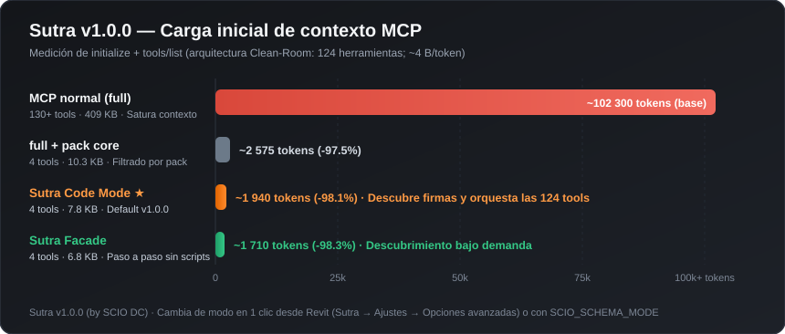

<p align="center">
  
</p>

<h1 align="center">Sutra — Revit MCP</h1>

<p align="center">
  <strong>Clean-room, modular, local-first Model Context Protocol bridge for Autodesk Revit 2023–2027</strong><br/>
  Built from scratch by <strong>Marco Poma · SCIO DC</strong> (Grupo POVA, Lima, Peru — <em>we model like those who have already built</em>)
</p>

<p align="center">
  <a href="README.es.md"><strong>Español</strong></a> · <strong>English</strong>
</p>

<p align="center">
  <a href="https://github.com/mpomav/sutra-revit-mcp/releases/latest"></a>
  
  
  
  <a href="PROVENANCE.md"></a>
  <a href="LICENSE"></a>
</p>

---

**Sutra** *(from the Nepali/Sanskrit **Sutradhara** — the master builder who holds the layout cord)* is a **clean-room, modular MCP server and Autodesk Revit 2023–2027 add-in** connecting AI assistants (**Claude Desktop, Claude Code, Codex, Cursor, Windsurf, ChatGPT Work**) to a live Revit session on Windows.

Built from scratch across **9 domain modules** and **130 verified tools** (118 Revit module tools + 9 host-resident tools — see [PROVENANCE.md](PROVENANCE.md)).

### Why Sutra is built differently

1. **Transactional safety (`rehearse → commit → re-read`):** Typed mutating tools default to `dry_run: true`, run inside Revit transactions, and verify post-commit state directly from the model.
2. **In-process C# + local SQLite for real Revit bottlenecks:** Heavy inventories and takeoffs execute in-process inside Revit, write full CSVs locally, and index into SQLite (`scio_query_local`, `scio_progress_takeoff`, `scio_report`, `scio_batch_audit`) so large models never clog the chat.
3. **Clean context without tool-selection degradation (`Code Mode` default):** Exposing 100+ tool schemas at once saturates initial context and degrades LLM tool selection. **Sutra v1.0.0** defaults to **Code Mode** (`SCIO_SCHEMA_MODE=codemode`), exposing 4 meta-tools with on-demand `scio_list_tools` / `scio_describe_tool` and a hardened, fail-closed local JS sandbox (`read_only: true` default, strict memory/step/timeout limits, zero raw Python access).

---

## Initial context footprint & AI modes



Switch between **`codemode`** *(default)*, **`facade`**, and **`full`** via `SCIO_SCHEMA_MODE` or `%USERPROFILE%\.scio\settings.json` (`"schema_mode"`). Full guide: [docs/TOKEN-MODES.md](docs/TOKEN-MODES.md).

---

## Clean-Room Modular Architecture (130 tools)

| Layer / Module | Role |
| --- | --- |
| **`Scio.Abstractions`** | Attribute-driven `[ScioTool]` contracts, reflection JSON Schema generation, and standardized verification envelopes. |
| **`Scio.Ipc`** | Length-prefixed Windows Named Pipes hardened with `PipeOptions.CurrentUserOnly` (`.NET 8/10`) and per-user SID `PipeSecurity` ACL (`.NET 4.8`), with cancellation, timeouts, and FIFO queuing. |
| **`Scio.Server`** | Standalone MCP stdio host (`codemode` / `facade` / `full`), hardened `CodeModeEngine`, local SQLite analytics (`scio_query_local`, `scio_report`, `scio_batch_audit`, `scio_progress_takeoff`), workflow recommender (`scio_suggest_workflow`), and opt-in telemetry (`scio_telemetry`, **OFF by default**). |
| **`Scio.Revit.Host` & `Sdk`** | Multi-target Revit add-in (`net48` for 2023–2024, `net8.0-windows` for 2025–2026, `net10.0-windows` for 2027) with dynamic module discovery. |
| **`Scio.Revit.Ui`** | Native **Sutra** ribbon tab, unified theme (`ScioTheme`), and AI client handoff tools. |
| **9 Domain Modules (118 tools)** | `CoreRead` (22), `ScioNative` (11), `Modeling` (19), `Documentation`, `AuditQa`, `Mep`, `Structure`, `CadIfc`, `IsoInterop`. |
| **`Scio.Revit.Python`** | Owner-gated isolated IronPython escape hatch (disabled by default). |

---

## Install & Build (Windows · Revit 2023–2027)

Close all Autodesk Revit sessions before installing.

### From release installer (recommended)
Download `sutra-revit-mcp-1.3.0-setup.exe` from [GitHub Releases](https://github.com/mpomav/sutra-revit-mcp/releases/latest) and run it. The installer automatically detects and upgrades previous Sutra/SCIO installations across all installed Revit versions (`2023–2027`).

### Build from source (requires .NET SDK)
```powershell
git clone https://github.com/mpomav/sutra-revit-mcp.git
cd sutra-revit-mcp
powershell -ExecutionPolicy Bypass -File .\build\build-all.ps1
powershell -ExecutionPolicy Bypass -File .\install.ps1
```

### Connect your AI client
```powershell
# Claude Code
claude mcp add --scope user sutra-revit -- "C:\Users\<you>\AppData\Local\Programs\Scio\MCP\server\scio-revit-mcp.exe"
```

---

## Privacy, Security & Clean-Room Provenance

- **100% local execution:** your Revit models never leave your machine.
- **Hardened Code Mode:** `read_only` defaults to `true`, `scio_call_tool` and raw Python are blocked, with strict step/memory/timeout ceilings.
- **Opt-in telemetry (`scio_telemetry`):** **OFF by default** (`telemetry_opt_in: false`). When explicitly enabled by the owner, records only anonymous tool counts, timings, schema mode, 2-letter OS region, and version — never IPs, file paths, or model data.
- **Clean-room audited:** verified 0% upstream code reuse in [PROVENANCE.md](PROVENANCE.md) and `build/audit-clean-room.ps1`.

---

## License

Apache-2.0 — see [LICENSE](LICENSE) and [THIRD-PARTY-NOTICES.md](THIRD-PARTY-NOTICES.md).
Copyright 2026 **Marco Poma · SCIO DC** (Lima, Peru).
