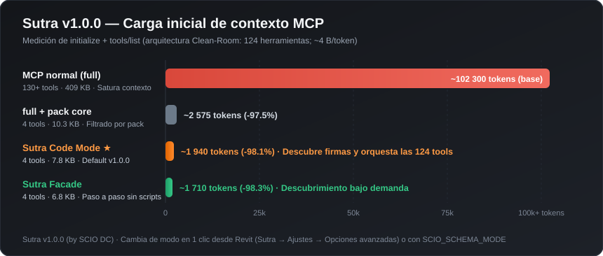

# Guía de modos de contexto / AI Context & Token Modes — Sutra v1.0.0

El contrato completo de **Sutra v1.0.0** (arquitectura Clean-Room modular) reúne **130 herramientas tipadas** (118 en 9 módulos de Revit + 9 locales en el servidor). En un servidor MCP convencional, anunciar todo el catálogo al abrir el chat **satura la ventana de contexto inicial** y provoca **degradación de selección de herramientas** (*tool selection degradation*): al pasar de 30–50 esquemas, los LLMs confunden argumentos entre herramientas parecidas. Además, aunque el *prompt caching* reduce el costo económico en turnos posteriores, **no libera ventana de contexto** ni evita los límites estrictos de planes gratuitos.

**Sutra** resuelve esto con **tres modos de superficie**, arrancando en **`codemode`** por defecto:



## Comparación medida sobre el binario `v1.0.0` (perfil `safe_write`)

| Modo | Herramientas en `tools/list` | Bytes UTF-8 (`initialize` + `tools/list`) | Tokens iniciales estimados* | Reducción vs `full` | Cuándo elegirlo |
| --- | ---: | ---: | ---: | ---: | --- |
| **`codemode`** *(por defecto)* | 4 | 7 760 B | ~1 940 – 2 350 | **−98.1 %** | **Uso general, tareas multi-paso y cuentas gratuitas** |
| **`facade`** | 4 | 6 842 B | ~1 710 – 2 070 | **−98.3 %** | **Flujos paso a paso sin scripts** con mínimo contexto inicial |
| **`full` + `pack core`** | 4 | 10 300 B | ~2 575 – 3 120 | **−97.5 %** | Uso acotado a un solo ToolPack |
| **`full`** | 130+ *(de 149 totales)* | 409 224 B | ~102 300 – 130 000 | base | Clientes Pro / Max / API que prefieren ver el catálogo directo |

*\*Rango estimado entre 4.0 bytes/token (texto estándar) y 3.3 bytes/token (JSON denso).*

---

## Cómo evita `Code Mode` alucinar firmas

A diferencia de un ejecutor a ciegas, **`scio_code_mode`** no obliga al modelo a adivinar las 149 firmas ni compila C#:

1. Expone **`scio_list_tools`** y **`scio_describe_tool`** (y dentro del propio script `scio.search(query)` y `scio.describe(name)`) para leer el esquema exacto bajo demanda antes de invocar.
2. Ejecuta un **intérprete de subconjunto de JavaScript en sandbox local** (cero red, cero disco, cero reflexión .NET, límites duros de pasos/tiempo/bytes).
3. **Solo despacha herramientas tipadas de Sutra** pasando por exactamente las mismas puertas de seguridad (permisos, ToolPacks, `dry_run`, `confirmation_token` y relectura post-commit en Revit). `scio_execute_python` y la recursión están bloqueados de forma incondicional.

---

## Cómo cambiar de modo

### Opción 1 — En 1 clic desde Revit (recomendada)

1. Abre la pestaña **Sutra** en la cinta de Revit.
2. Entra a **Ajustes → Opciones avanzadas → General**.
3. En **Modo de consumo de tokens (IA)**, pulsa el modo que prefieras:
   - **Code Mode (~2k · Gratis)**
   - **Facade (~1.7k · Gratis)**
   - **Full (~102k · Pro/API)**

Sutra guarda la preferencia en `%USERPROFILE%\.scio\settings.json` (`"schema_mode"`) y notifica automáticamente a los clientes MCP compatibles (`notifications/tools/list_changed`). Si tu cliente ignora la notificación, reinícialo una vez.

### Opción 2 — Por variable de entorno (tiene prioridad sobre `settings.json`)

```json
{
  "mcpServers": {
    "scio-revit": {
      "command": "C:\\Users\\<TU_USUARIO>\\AppData\\Local\\Programs\\Scio\\MCP\\server\\scio-revit-mcp.exe",
      "env": {
        "SCIO_SCHEMA_MODE": "codemode"
      }
    }
  }
}
```

Valores válidos: `codemode`, `facade`, `full`.
